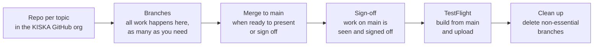

# Git Workflow: Repos & Branches at KISKA

## Overview

Work moves through three places: your branches while you work, `main` once it's ready to present, and TestFlight once it's signed off. This guide is for anyone new to KISKA's GitHub setup.



Nothing goes to `main` until it's ready to show, and nothing goes to TestFlight until it's signed off.

## Where repos live

Every repo goes in the KISKA GitHub organization: [github.com/kiskainteraction](https://github.com/kiskainteraction). Never create work repos under your personal account.

Create **one repo per topic or project**. A client with several topics gets several repos; a single project gets one.

| Case | Repos | Example names |
| --- | --- | --- |
| Several topics for one client | One repo per topic | `loxone-app`, `loxone-<topic>` |
| A single project | One repo for the project | `rika` |

Suggested naming: lowercase, words joined with hyphens, client or project name first, so related repos sort together.

Before creating a new repo, check the organization to make sure one doesn't already exist for your topic.

## Working in branches

All work happens in branches, never directly on `main`. `main` only holds work that is ready to present or has been signed off.

- Start a branch for the topic you're working on.
- Create as many branches as you need: one per feature, screen, experiment or fix is fine.
- Commit and push your branch often, so the work is backed up on GitHub and others can see progress.
- Keep each branch focused on one thing; it makes the merge to `main` easier to review.

Suggested branch names: `feature/<short-description>` for new work and `fix/<short-description>` for corrections, e.g. `feature/climate-screen`.

**Name your branch before you start coding with Claude.** Create the branch first, so every change Claude makes lands there and not on `main`. If the name stops fitting, you can rename it later on GitHub: go to the repo's Branches page and click the pencil icon next to the branch.

```bash
git checkout main
git pull
git checkout -b feature/climate-screen
# ...work...
git add .
git commit -m "Add climate screen layout"
git push -u origin feature/climate-screen
```

## Merging to main

Merge your branch into `main` once the work is ready to present or to be signed off. That means either:

- the status has been agreed and signed off, or
- you're happy with the result and it's ready to show for sign-off.

Unfinished or experimental work stays in its branch.

**How to merge**

1. Push your latest commits to the branch.
2. On GitHub, open a pull request from your branch into `main`.
3. Describe what changed and what you want feedback on.
4. Merge the pull request into `main`.
5. Delete the branch if the topic is done, or keep working in it for the next round.

```bash
git push
# then open a pull request on GitHub: your branch → main
```

## Pushing to TestFlight

Only push to TestFlight after the work on `main` has been seen and signed off. TestFlight builds are what testers and stakeholders install, so they must come from signed-off work.

- Build from `main`, never from a feature branch.
- Pull the latest `main` first, so the build matches what was signed off.
- Upload the build to TestFlight (in Xcode: Product → Archive, then Distribute App).

```bash
git checkout main
git pull
# build and upload to TestFlight from this state
```

**After sign-off: clean up branches**

Once something is signed off, hide the non-essential branches so the repo stays clean and easy to understand for everyone.

- Keep `main` and any branch someone is still actively working on.
- Delete the rest: merged branches, abandoned experiments and alternatives that weren't chosen. On GitHub this is how you hide a branch.
- A branch deleted from a pull request can be brought back with the **Restore branch** button on that pull request.

## Example: the Loxone App

Here's the full cycle for one piece of work on the Loxone App.

1. **Find the repo.** The Loxone App has its own repo in [kiskainteraction](https://github.com/kiskainteraction).
2. **Name your branch first.** Before you start coding with Claude, you create `feature/climate-screen` off `main`.
3. **Work in branches.** You try two layout ideas, so you also create `feature/climate-screen-alt`. Commit and push both as you go.
4. **Get it ready.** You pick the layout you're happy with and it's ready to present.
5. **Merge to `main`.** Open a pull request from `feature/climate-screen` into `main` and merge it. The alternative branch stays unmerged.
6. **Present and sign off.** The work on `main` is reviewed and signed off.
7. **Push to TestFlight.** Pull the latest `main`, build, and upload it to TestFlight.
8. **Clean up.** Delete `feature/climate-screen` and `feature/climate-screen-alt`, so only `main` and active work remain.

## Quick reference

| Stage | Where the work lives | Move on when |
| --- | --- | --- |
| Work in progress | Your branch(es) | You're happy with it, or the status is signed off |
| Ready to present | `main` | It has been seen and signed off |
| Signed off | TestFlight build from `main` | — |

**Checklist before merging to `main`**

- [ ] Repo is in the kiskainteraction organization
- [ ] Work is on its own branch, pushed to GitHub
- [ ] Result is ready to present or already signed off
- [ ] Pull request opened into `main` with a short description

**Checklist before pushing to TestFlight**

- [ ] Work on `main` has been seen and signed off
- [ ] Local `main` is up to date (`git pull`)
- [ ] Build made from `main`, not a branch
- [ ] Non-essential branches deleted after sign-off
